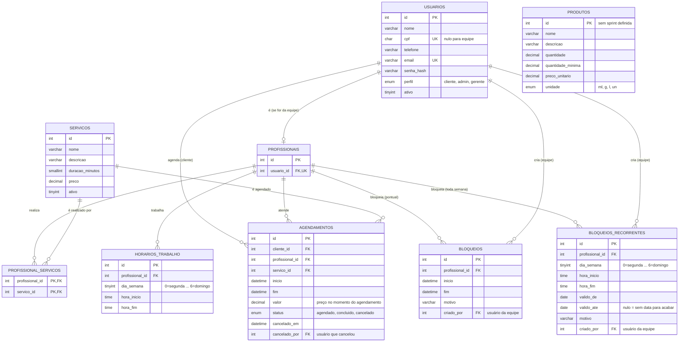

# Modelo de Dados (MER) — Time 12

Proposta inicial do modelo relacional, feita a partir de `docs/requisitos.md` e `docs/sprints.md`.
**Precisa da revisão do Eduardo** antes de ser considerada final (Seção 9 do relatório).

Convenções:
- Tabelas e colunas em português, no singular para colunas e plural para tabelas.
- Toda tabela tem `id` inteiro auto incremento como chave primária.
- Exclusões de usuários e serviços são lógicas (`ativo = 0`), para não perder o histórico
  de agendamentos usado pelo BI.

## Diagrama

As tabelas marcadas como *(Sprint N)* ainda não têm migration; entram quando a sprint começar.
Migrations aplicadas: `001` (usuários, serviços, profissionais, horários), `002` (agendamentos) e `003` (bloqueios).

## Decisões e justificativas

| Decisão | Por quê |
|---|---|
| Profissional é um usuário com perfil `admin` ou `gerente` + linha em `profissionais` | O RF08 diz que o gerente define o nível de acesso do profissional, então todo profissional faz login. A tabela separada garante que um agendamento só aponte para quem é da equipe. |
| Perfil como `ENUM` em `usuarios` | São só três perfis fixos e o gerente herda o admin; uma tabela de papéis seria complexidade sem ganho agora. |
| CPF e telefone só com dígitos e opcionais | Obrigatórios no cadastro do cliente (validado na API), mas funcionários podem ser cadastrados só com nome e e-mail. São dados pessoais (LGPD). |
| Um intervalo de trabalho por dia | Pausas (almoço, consulta médica) são feitas com `bloqueios`, como descrito na Sprint 3. |
| `agendamentos.valor` guarda o preço do dia | Se o preço do serviço mudar, a receita histórica do BI continua correta. |
| Bloqueios em duas tabelas: `bloqueios` (pontuais) e `bloqueios_recorrentes` (semanais) | Modelo do Eduardo (issue #19, migration 003). Cada tipo tem campos diferentes; separados, as colunas de data e hora são `NOT NULL` e as restrições ficam simples. O recorrente segue o padrão de `horarios_trabalho`: uma linha por dia da semana. |
| Recorrente com `valido_de` / `valido_ate` | Permite regras com período ("almoço às 12h só em novembro") e encerrar uma regra sem apagar a linha. `valido_ate` nulo = vale sem data para acabar. |
| Bloqueio removido é apagado (`DELETE`) | Bloqueio não entra na receita nem nos indicadores do BI, então não há histórico a preservar. |
| Cancelamento muda o `status` para `cancelado`, sem apagar a linha | Na tela, "Excluir agendamento" (RF06) marca como cancelado e grava quem cancelou e quando. A checagem de conflito e a lista de horários livres ignoram os cancelados, então o horário fica livre na hora. O BI conta só os `concluido` na receita e pode mostrar a taxa de cancelamento. |

## Pontos para o Eduardo revisar

1. Estoque (RF09) ainda não está em nenhuma sprint do `docs/sprints.md` (o Luiz vai incluir).
2. ~~Índice em `agendamentos (profissional_id, inicio)`~~: criado na migration 002, junto com `(cliente_id, inicio)`.
3. ~~Bloqueios (issue #19)~~: modelado pelo Eduardo na migration 003 (PR #60), com duas tabelas.
